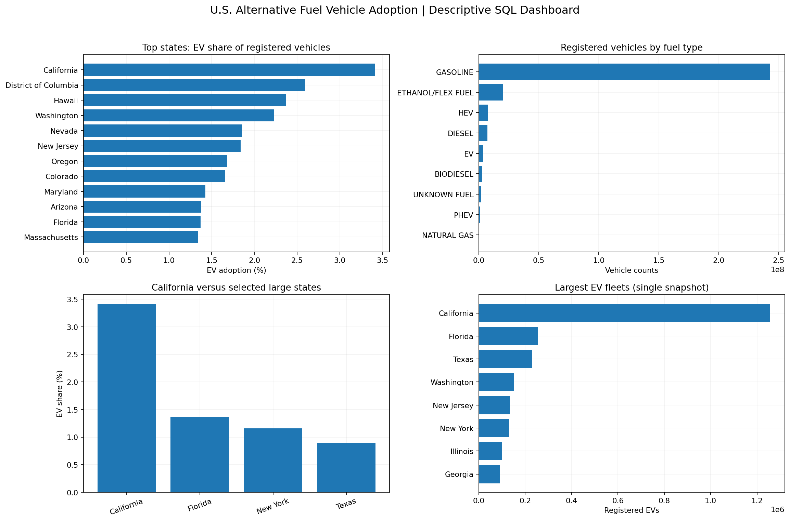

# U.S. Alternative Fuel Vehicles — State Adoption & Infrastructure Screening

## Policy objective
Compare EV/PHEV/HEV/gasoline registration shares and other fuel categories; screen states for follow-up charging-network investment analysis without inventing missing infrastructure or time trends.

## Source and scope
- Input: `Vehicle Data.csv`; format: **WIDE**; period: **undated snapshot**.
- Source rows: **51**; valid fuel-state records after cleaning: **612**.
- **51** state/jurisdiction labels in the snapshot. Fuel shares use the sum of mutually exclusive observed fuel-category counts, **not** population or vehicle-miles driven.
- If source fuel categories overlap (for example 'flex-fuel' labels might overlap gasoline), percentages cannot be interpreted as a single mutually exclusive registered-fleet mix until source definitions are checked.
- Missing/invalid counts are excluded, not assumed zero. Zero reported registrations are valid observations but may also reflect incomplete reporting.
- Latest-year snapshot is used for rankings; multi-year trends are shown only if distinct years exist.

## Executive state comparisons
| state | total_vehicles | EV | PHEV | HEV | GASOLINE | ev_adoption_pct |
| --- | --- | --- | --- | --- | --- | --- |
| California | 36850300 | 1256600 | 410700 | 1703200 | 31191900 | 3.41 |
| District of Columbia | 312100 | 8100 | 3700 | 18100 | 262500 | 2.595 |
| Hawaii | 1080100 | 25600 | 7300 | 36400 | 951000 | 2.37 |
| Washington | 6816100 | 152100 | 41200 | 307200 | 5583000 | 2.231 |
| Nevada | 2556100 | 47400 | 10600 | 69600 | 2169300 | 1.854 |
| New Jersey | 7324100 | 134800 | 40900 | 174200 | 6433000 | 1.84 |
| Oregon | 3832700 | 64400 | 28800 | 156900 | 3074300 | 1.68 |
| Colorado | 5441800 | 90100 | 37500 | 152700 | 4508800 | 1.656 |
| Maryland | 5060000 | 72100 | 31300 | 168700 | 4327800 | 1.425 |
| Arizona | 6529000 | 89800 | 25600 | 175700 | 5469000 | 1.375 |

## Top five states by EV market share
| state | ev_vehicles | total_vehicles | ev_adoption_pct |
| --- | --- | --- | --- |
| California | 1256600 | 36850300 | 3.41 |
| District of Columbia | 8100 | 312100 | 2.595 |
| Hawaii | 25600 | 1080100 | 2.37 |
| Washington | 152100 | 6816100 | 2.231 |
| Nevada | 47400 | 2556100 | 1.854 |

## Bottom five states by EV market share
| state | ev_vehicles | total_vehicles | ev_adoption_pct |
| --- | --- | --- | --- |
| North Dakota | 1000 | 797400 | 0.125 |
| Mississippi | 3600 | 2723300 | 0.132 |
| Wyoming | 1100 | 652900 | 0.168 |
| West Virginia | 2800 | 1510900 | 0.185 |
| South Dakota | 1700 | 918000 | 0.185 |

## California compared with large states
| state | total_vehicles | EV | PHEV | HEV | GASOLINE | ev_adoption_pct |
| --- | --- | --- | --- | --- | --- | --- |
| California | 36850300 | 1256600 | 410700 | 1703200 | 31191900 | 3.41 |
| Florida | 18583200 | 254900 | 57300 | 414500 | 16136500 | 1.372 |
| New York | 11318600 | 131300 | 92300 | 314000 | 9905500 | 1.16 |
| Texas | 25796600 | 230100 | 55300 | 445100 | 21392800 | 0.892 |

## National fuel category distribution
| fuel | registered_vehicles | national_share_pct | states_reporting_positive |
| --- | --- | --- | --- |
| GASOLINE | 242870900 | 84.596 | 51 |
| ETHANOL/FLEX FUEL | 20240600 | 7.05 | 51 |
| HEV | 7392300 | 2.575 | 51 |
| DIESEL | 7184300 | 2.502 | 51 |
| EV | 3555900 | 1.239 | 51 |
| BIODIESEL | 2803600 | 0.977 | 51 |
| UNKNOWN FUEL | 1694100 | 0.59 | 51 |
| PHEV | 1307200 | 0.455 | 51 |
| NATURAL GAS | 24700 | 0.009 | 41 |
| HYDROGEN | 16900 | 0.006 | 1 |
| PROPANE | 6000 | 0.002 | 22 |

## Adoption trends
Only one registration snapshot was supplied. EV adoption growth and accelerating/decelerating adoption **cannot be determined** from this file.

## Three provisional infrastructure investment candidates
**California, Washington, New Jersey** — selected using a transparent combined EV fleet-count and adoption-share screening score, **not** a documented charger shortfall.
| state | EV | total_vehicles | ev_adoption_pct | screening_score |
| --- | --- | --- | --- | --- |
| California | 1256600 | 36850300 | 3.41 | 1.0 |
| Washington | 152100 | 6816100 | 2.231 | 0.941 |
| New Jersey | 134800 | 7324100 | 1.84 | 0.912 |

No verified public charging-station coverage/capacity data was supplied. Infrastructure gaps cannot be measured or asserted from registrations alone.

## Data quality and methodology
1. Identify wide or long registration schema and standardize state abbreviations/names plus common fuel labels.
2. Audit missing, negative and fractional registration counts; retain original reported labels for unknown fuel categories.
3. Use the most recent valid year for current snapshot rankings; don't double-count source TOTAL categories.
4. Aggregate fuel counts per state with SQLite; compute EV, PHEV, HEV, gasoline percentages using observed totals.
5. Reconcile national counts and state shares; flag any source-total discrepancies.
6. Review fuel classifications: biodiesel blends, ethanol/flex-fuel compatibility and hydrogen registrations may not be comparable or disjoint without the dataset dictionary.
7. Export audited CSVs, static Python dashboard, recommendations, and a validated ZIP.

## Files / reproduction
Open `US_Alternative_Fuel_Vehicle_Adoption_SQL_Analysis.ipynb` in Google Colab, upload the original CSV to `/content`, optionally set `DATA_FILE` and `INFRA_FILE`, run all seven cells, and check `VALIDATION: PASS` and `PACKAGE READY`. Results save to `/content/Project10_EV_Outputs`. The notebook is downloaded separately from the ZIP. A local SQLite database is intentionally excluded from GitHub packaging.

## Technology and limitations
Python, pandas, SQLite SQL, Matplotlib and Excel-compatible CSVs. The dashboard is static Python; **no Tableau workbook is claimed**. Without charging-station/port data, electricity grid capacity, utilization, traffic, per-capita registrations, and regulatory context, prioritization remains preliminary. This dataset cannot measure actual adoption *growth* without multiple comparable years.

## Repository
`US-Alternative-Fuel-Vehicle-Adoption-Analytics` | https://github.com/new
